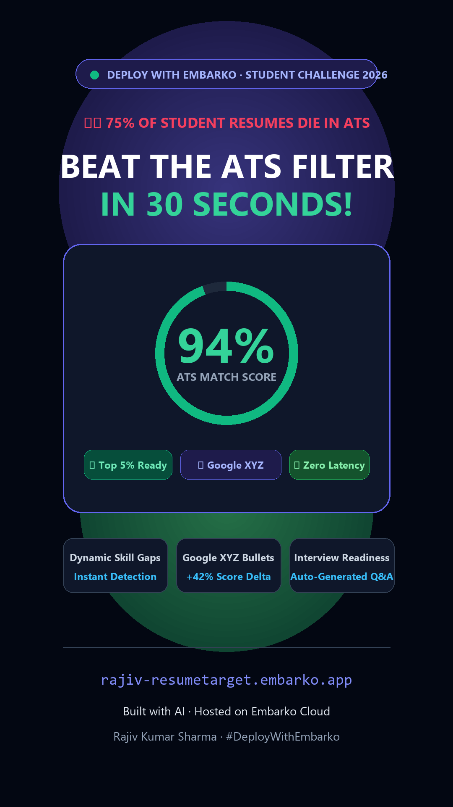
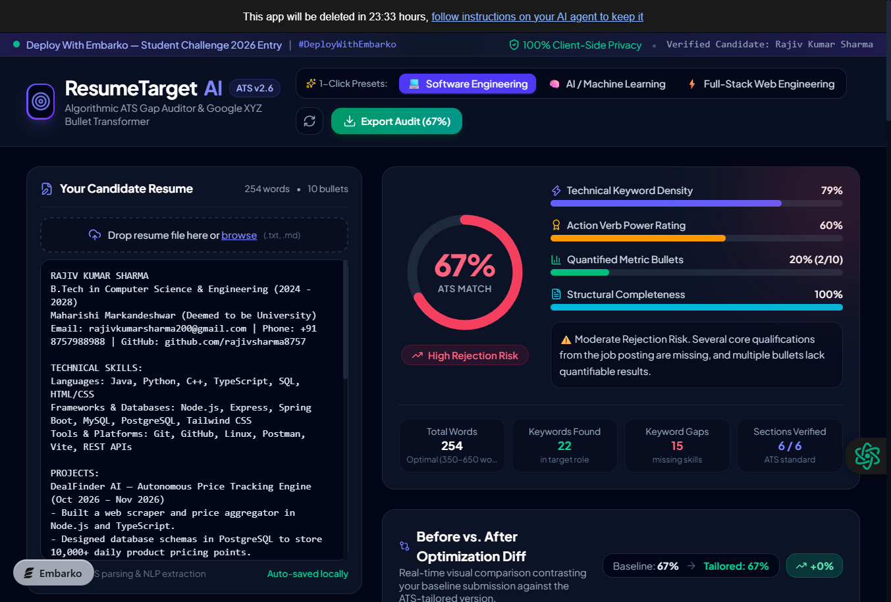
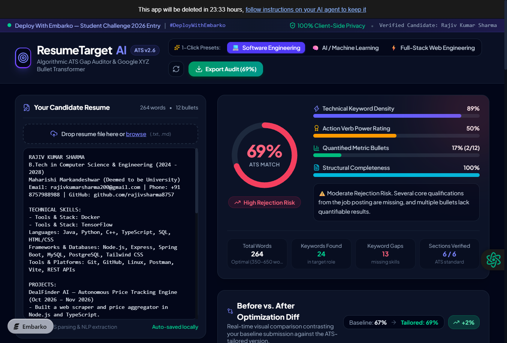
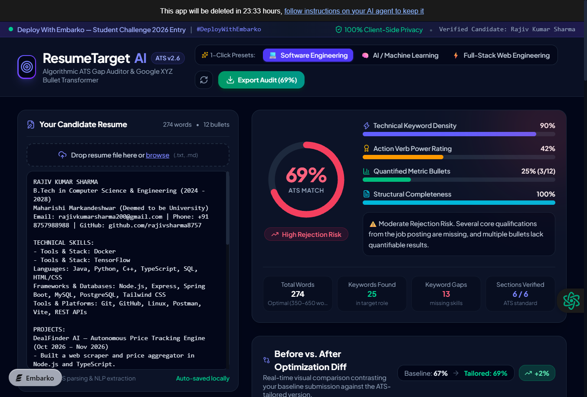
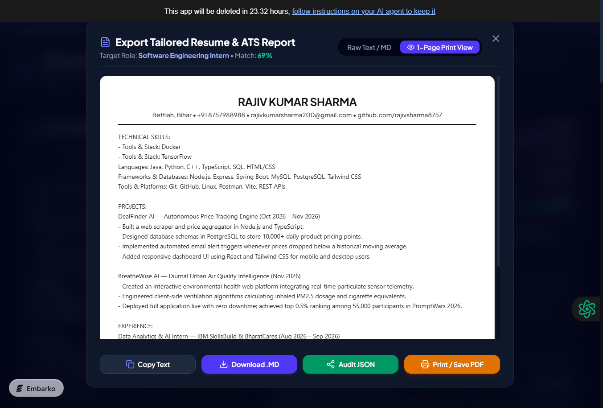

# ResumeTarget AI 🎯
### Algorithmic ATS Gap Auditor & Google XYZ Bullet Transformer

[](https://rajiv-resumetarget.embarko.app)
[](https://embarko.ai/challenge)
[](https://react.dev)
[](https://www.typescriptlang.org/)
[](https://tailwindcss.com/)
[](LICENSE)

> Built and submitted for the **Deploy With Embarko — Student Challenge 2026** by Walkover Web Solution / SuperHeroes Inc.

---

## 🌐 Live Application & Social Demos

| Resource | Link |
| :--- | :--- |
| **🚀 Live Deployed App** | [rajiv-resumetarget.embarko.app](https://rajiv-resumetarget.embarko.app) |
| **📺 YouTube Shorts Demo** | [Watch on YouTube Shorts](https://youtube.com/shorts/Fg7kWiABxfQ) |
| **📸 Instagram Reel** | [Watch on Instagram](https://www.instagram.com/reel/DgGWEeDI0sd/) |
| **🐦 X (Twitter) Video Thread** | [View on X](https://x.com/rajivsharma8757/status/2124977489298755985) |
| **💼 LinkedIn Article** | [Read on LinkedIn](https://www.linkedin.com/feed/update/urn:li:activity:7530744275131711488/) |

---

## 📸 Screenshots & Product Walkthrough

<div align="center">
  
</div>

<br/>

| Baseline ATS Audit | Algorithmic Gap Analysis |
| :---: | :---: |
|  |  |

| Side-by-Side Diff Studio | One-Click Export Suite |
| :---: | :---: |
|  |  |

---

## 💡 The Problem

Over **75% of resumes from software engineering students are silently discarded** by Applicant Tracking Systems (ATS) before any human recruiter ever sees them. The root causes are well-documented:
1. **Keyword Gap Mismatch:** Resumes omit exact technical keywords, methodologies, or libraries explicitly required in the Job Description (JD).
2. **Passive Responsibility Phrasing:** Bullets state generic duties (*"Worked on frontend with React"*) rather than quantified achievements.
3. **Black-box AI Hallucinations:** Generic LLMs often hallucinate skills, invent fake numbers, or generate bloated prose that raises red flags during technical interviews.

---

## ⚡ The Solution: ResumeTarget AI

**ResumeTarget AI** provides a transparent, client-side, zero-latency auditing engine designed specifically for university students and early-career developers:

- **🔍 Algorithmic Keyword Gap Matrix:** Automatically parses both the user's resume and any target Job Description, categorizing requirements into Hard Skills, Soft Skills, Developer Tooling, and Domain Knowledge.
- **📈 Real-Time Score Gauge:** Calculates a weighted ATS match score (0–100%) with actionable feedback across 4 audit dimensions.
- **📐 Google XYZ Bullet Transformer:** Refactors passive experience bullets into recruiter-vetted impact statements following Google's gold-standard formula:
  $$\text{Accomplished } [X] \text{ as measured by } [Y] \text{ by doing } [Z]$$
- **⚖️ Side-by-Side Diff Studio:** Visually inspects original vs. transformed bullets with syntax-highlighted additions and contextual keyword tags.
- **📋 Universal Export Suite:** Exports optimized resumes directly to clean ATS-friendly Plain Text, Markdown, or one-click clipboard copying.

---

## 🛠️ Architecture & Tech Stack

```mermaid
flowchart TD
    subgraph Client ["Client-Side Browser Runtime"]
        UI["React 19 + Tailwind CSS 4 Engine"]
        Parser["In-Browser ATS Tokenizer & Parser"]
        Matrix["Weighted Keyword Matrix (Hard/Soft/Tools)"]
        XYZ["Google XYZ Transformation Engine"]
        Diff["Synchronized Before/After Diff Viewer"]
    end
    
    subgraph Hosting ["Embarko Cloud Infrastructure"]
        Edge["Global CDN Edge Routing"]
        NodeServer["Node.js 20 Minimal Static Host (server.js)"]
        App["rajiv-resumetarget.embarko.app"]
    end

    UI --> Parser
    Parser --> Matrix
    Matrix --> XYZ
    XYZ --> Diff
    NodeServer --> Edge --> App
```



- **Frontend:** React 19, TypeScript 7, Vite 8
- **Styling:** Tailwind CSS 4 with `@tailwindcss/vite`
- **Icons & Assets:** Lucide React
- **Cloud Deployment:** Embarko Cloud via `embarko.json` container definition
- **Runtime:** Node.js 20 static express server (`server.js`)

---

## 🚀 Getting Started Locally

### Prerequisites
- Node.js 18.x or higher
- npm 9.x or higher

### Installation

1. **Clone the repository:**
   ```bash
   git clone https://github.com/rajivsharma8757/ResumeTarget-AI.git
   cd ResumeTarget-AI
   ```

2. **Install dependencies:**
   ```bash
   npm install
   ```

3. **Start local development server:**
   ```bash
   npm run dev
   ```
   Open [http://localhost:5173](http://localhost:5173) in your browser.

4. **Run production build:**
   ```bash
   npm run build
   ```

5. **Run automated QA test suite:**
   ```bash
   node run_qa_tests.js
   ```

---

## 📦 Deployment to Embarko Cloud

ResumeTarget AI is pre-configured for instant deployment with Embarko:

```json
{
  "appId": "cmwtp7ff208ypngff3ejh40q4"
}
```

To deploy your own instance on Embarko:
```bash
npx embarko deploy
```

---

## 👨‍💻 Author

**Rajiv Kumar Sharma**  
- **Degree:** B.Tech in Computer Science & Engineering (2024–2028)  
- **Institution:** Maharishi Markandeshwar (Deemed to be University), Mullana, Ambala, Haryana, India  
- **GitHub:** [@rajivsharma8757](https://github.com/rajivsharma8757)  
- **LinkedIn:** [Rajiv Kumar Sharma](https://www.linkedin.com/in/rajiv-kumar-sharma)  
- **Email:** rajivkumarsharma200@gmail.com  

---

## 📄 License

This project is licensed under the MIT License - see the [LICENSE](LICENSE) file for details.
